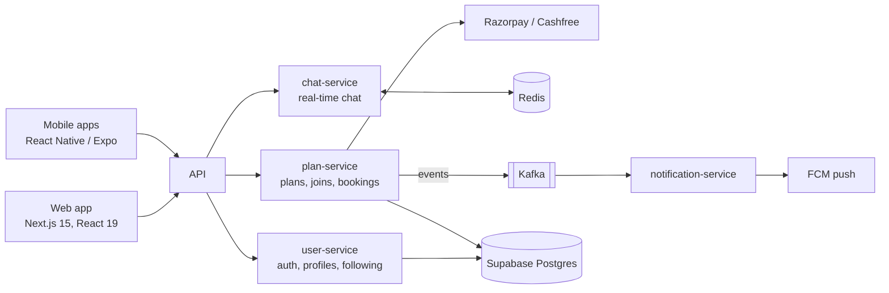

# Planstalk

**A live event platform: website plus iOS and Android apps.** People discover events and plans, book and pay, and
chat with the group. → [planstalk.com](https://www.planstalk.com)

I co-founded Planstalk and led its development.

> The source code is private. This page describes the product, the architecture and the main engineering problems.
> I'm happy to walk through the code in an interview.

## In numbers

- **100+ users** across **20+ events** in India
- **Rs. 1,00,000+** in paid bookings processed
- Web app plus iOS and Android apps from one team

## Architecture

The backend is a NestJS monorepo of microservices (user, plan, chat, notification) with shared DTOs and utilities,
run locally with Docker Compose.

## Engineering problems I solved

- **No duplicate bookings.** The payment flow on Razorpay and Cashfree is idempotent, so a retried or double-tapped
  payment never creates a second booking.
- **Real-time group chat** over WebSockets, with Redis behind it.
- **Push notifications through Kafka.** Services publish events and the notification service sends them through
  Firebase Cloud Messaging, so no request waits on a notification.
- **One product on three platforms**, with a Next.js website and React Native (Expo) apps.

## Stack

Next.js 15 · React 19 · TypeScript · React Native (Expo) · NestJS · Kafka · Redis · WebSockets ·
Supabase (Postgres) · Razorpay · Cashfree · Resend · Docker
